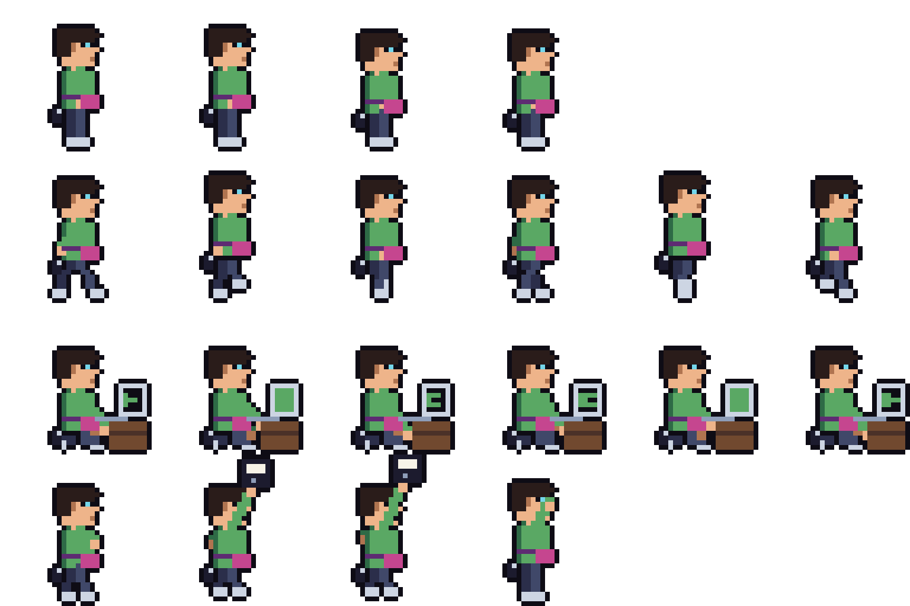

# Disquete

Disquete (Enzo): sprites, animações, retrato, habilidade, eventos, bico.

## Personalidade

Aprendeu a programar num TK-90X de segunda mão e nunca mais saiu da frente de uma tela. Monta e desmonta computador de CPD como quem troca pneu, conhece modem discado pelo chiado e jura que qualquer sistema "roda até em 286, relaxa". Fala em gíria de informática de 1992: "tô dentro", "deu pau", "reinicia", "baixando, peraí". Mania: anda com uma caixinha de disquetes 5¼ etiquetados à mão e assopra tudo que tem encaixe, de cartucho a fechadura eletrônica. Único medo: queda de luz no meio do download.

## Arte

Desenhada pixel a pixel por script, na paleta e no mesmo boneco do Gazua: cabelo cacheado, óculos fundo de garrafa, camiseta verde (a cor do tipo), pochete neon e tênis branco. Trabalha ajoelhado num micro em cima de um caixote com a tela piscando e comemora erguendo um disquete.

1. `python3 -B "Assets/_Project/Thieves/Disquete/Art/Source~/gerar_disquete.py"` (precisa de Pillow): sheet, retrato e ícones.
2. `python3 -B "Assets/_Project/Audio/Source~/gerar_sfx.py"`: os sons (teclado e fita rebobinando), junto com os da UI.
3. No Unity, **A Firma › Disquete › Gerar**: fatia o sheet, cria os clipes e o Animator, preenche `ThiefType_Disquete` (retrato, Animator, som de ação), a habilidade (ícone, som e VFX) e o bico (ícone).

## O que tem aqui

| Asset | O que é |
|---|---|
| `ThiefType_Disquete` | especialista em Sistema (câmeras, alarmes e computadores: é a passiva dele), 8 bordões, retrato, Animator e som de ação |
| `Ability_Disquete` | Loop na câmera: bota a câmera pra rodar o corredor vazio e congela o alerta por 15 s. Som de fita rebobinando e a telinha "LOOP" subindo da sala |
| `SideJob_Disquete` | Gatonet: puxa o sinal da TV por assinatura pro prédio, rende o dobro com um Disquete |
| `Events/` | 3 eventos em que ele brilha: Câmera nova no saguão (sala de Sistema, Lotérica+), Teclado do alarme (Joalheria+), O micro do CPD (sala de Sistema, Câmbio+). Todos têm saída pra crew sem Disquete |
| `Audio/` | `SFX_Disquete_Teclado` (digitando e o drive lendo, toca quando ele começa a trabalhar) e `SFX_LoopNaCamera` (videocassete rebobinando, clunk e o bipe do REC), sintetizados por `Audio/Source~/gerar_sfx.py` |
| `VFX/VFX_LoopNaCamera` | Monitor de vigilância com "LOOP" e REC que sobe da sala, com chiado verde. A Cena do Golpe instancia quando a habilidade é usada |
| `Icons/` | ícone do Loop na câmera (câmera dentro da seta) e do Gatonet (TV com o cabo puxado), 32×32 |

Falta: ajuste dos números com o Nicolas (#84).
