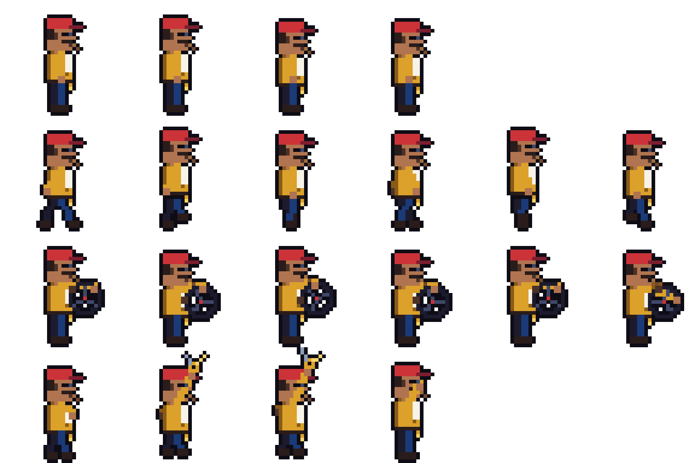
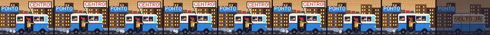

# PeNaTabua

Pé-na-Tábua (Leonardo): sprites, animações, retrato, habilidade, eventos, bico.

## Personalidade

Ex-motorista de lotação pirata. Conhece Nova Guanabara pelos buracos da rua, não pelo nome. Fala como quem tá dirigindo: "segura", "pisa", "retrovisor limpo". Mania: nunca desliga o motor e ninguém mexe no rádio AM, que só toca futebol. Único medo: lombada eletrônica.

## Arte

Desenhada pixel a pixel por script, na paleta e no mesmo boneco do Gazua e do Disquete: boné vermelho, óculos escuros, bigode, palito no canto da boca, jaqueta laranja (a cor do tipo) por cima da camiseta branca e o chaveiro da van no cinto. Trabalha ao volante (um volante solto na mão, esterçando pra lá e pra cá) e comemora sacudindo o chaveiro. O Cavalo de pau solta um "VRUUM!" de gibi com fumaça de pneu e poeira (`VFX/VFX_CavaloDePau`), e a van rodopia antes de arrancar.

1. `python3 -B "Assets/_Project/Thieves/PeNaTabua/Art/Source~/gerar_penatabua.py"` (precisa de Pillow): sheet, retrato e o "VRUUM!".
2. No Unity, **A Firma › Pé-na-Tábua › Gerar**: fatia o sheet, cria os clipes e o Animator, preenche `ThiefType_PeNaTabua` (retrato, Animator) e monta o VFX do Cavalo de pau na habilidade.

## O que tem aqui

| Asset | O que é |
|---|---|
| `ThiefType_PeNaTabua` | atributos, passiva de fuga (+4 s de contagem, +10% da sacola nas fugas com sirene, −15 pontos na chance de prisão) e 8 bordões |
| `Ability_PeNaTabua` | Cavalo de pau: fuga perfeita a qualquer hora, até com a polícia na porta |
| `SideJob_PeNaTabua` | Lotação pirata: rende o dobro com um Pé-na-Tábua |
| `Bico/` | cena do bico (spec no `Thieves/LEIA-ME.md`): a Kombi lotada no ponto, motor ligado, e o Pé-na-Tábua de cobrador gritando "CENTRO!"; vazia, a Kombi parada e apagada com "VOLTO JÁ" no vidro. `python3 -B "Assets/_Project/Thieves/PeNaTabua/Art/Source~/gerar_lotacao.py"` e depois **A Firma › Bicos › Ligar as cenas dos bicos** |
| `Audio/` | som de ação (partida de motor, CC0) e som do Cavalo de pau (pneu cantando, CC-BY 3.0: crédito no README) |
| `Icons/` | ícone do Cavalo de pau (volante girando) e do Lotação pirata (van), 32×32. Provisórios: recolorir quando a paleta sair |
| `Events/` | 3 eventos em que só ele resolve: Pneu arriado (Lotérica+), Feira na rua da van (Joalheria+), Helicóptero da PM (Cassino+) |

Falta: ajuste dos números com o Nicolas (#78).
