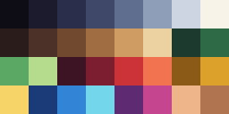
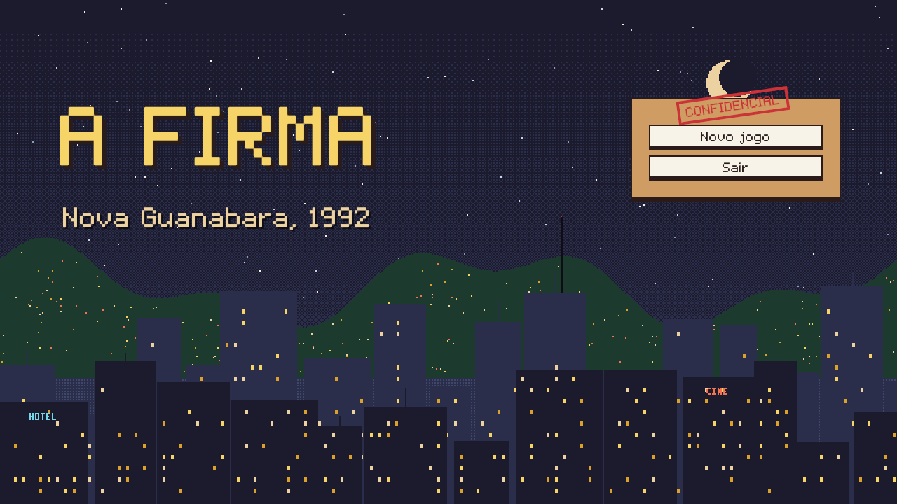

# Assets e direção de arte

> Dono da direção de arte: **Miguel** (cenário) e **Enzo** (UI). Mudanças aqui são combinadas no grupo.

## Regras

1. **Fonte principal: [craftpix.net](https://craftpix.net)**, com acesso pela faculdade. Complementos gratuitos (itch.io, Kenney, OpenGameArt) só quando o craftpix não tiver.
2. **Antes de baixar um pack, coloque ele na tabela abaixo** com status "proposto". Assim ninguém mistura estilos.
3. Tudo vai pra `Assets/ThirdParty/<NomeDoPack>/`. Não espalhe asset de terceiro pelas pastas do projeto: crie prefabs/sprites derivados na sua pasta.
4. Todo pack usado entra nos **Créditos do README** no mesmo PR.
5. **IA é permitida como ferramenta** (ex.: modelar no Blender e renderizar como pixel art, gerar base de sprite, música). Registre a ferramenta nos créditos e o que foi feito com ela.
6. Recolorir pra paleta do jogo é obrigatório: o jogo tem que parecer um só, não colagem de packs.

## Padrões técnicos (pixel art)

| Item | Padrão |
|---|---|
| Pixels por unidade (PPU) | **32** |
| Tamanho base dos ladrões | 32×32 |
| Retrato da UI | 64×64 (foto 3x4 do "dossiê") |
| Import de sprite | Filter Mode **Point**, Compression **None**, PPU 32 |
| Câmera | Pixel Perfect Camera (URP), referência 640×360, upscale pra 1280×720 |
| Paleta | 32 cores, abaixo (`HeistScene/Art/Paleta.png`). Os nomes estão em `HeistScene/Art/Source~/paleta.py` |
| Fonte da UI | **FirmaPixel** (`UI/Fonte/FirmaPixel.ttf`): a letra pixel da Cena do Golpe virada TTF, com acentos. Só em 11, 22, 33, 44 ou 66 px |

## Paleta

Linha a linha: a noite azulada de Nova Guanabara (ink → cream), a luz quente de interior e o kraft do dossiê (umber → paper), o verde do dinheiro, o vermelho do alarme, o ouro das lâmpadas e do cofre, o azul da viatura e da tela, o neon do cassino e dois tons de pele.

## Direção de arte da Cena do Golpe (Miguel)

- **Prédio em corte lateral**, salas de 192×96 px lado a lado, paredes de 8 px com porta, fachada por fora nos andares de cima e a rua com van, poste e orelhão. Um prédio por golpe, cada um com tema próprio (Lotérica verde-menta, Joalheria vinho e dourado, Câmbio de fórmica e vidro azul, Cassino roxo debaixo da pastelaria, Banco Central de mármore no subsolo com o túnel de terra).
- **Toda a arte da cena é desenhada pixel a pixel por script, já na paleta** (`HeistScene/Art/Source~/gerar_cena.py`): salas, adereços dos obstáculos (fechado/aberto), NPCs 32×32 no mesmo padrão do 171, fachadas, letreiros, fundo da cidade, ícones e uma fonte pixel com acento. Mudou o golpe, roda o script e o Unity refaz tudo (ver `HeistScene/LEIA-ME.md`).
- **Os packs de cenário do craftpix** (`StreetBackgrounds`, `NightCityTiles`) foram desenhados pra 1920×1080, três vezes a nossa escala (640×360 com PPU 32). Reduzidos, viram borrão; usados no tamanho original, ficam gigantes ao lado dos ladrões de 32 px. Eles ficaram como referência de clima (a noite azul-acinzentada inspirou a paleta) e a cena não depende do zip: quem clona o repositório já vê o jogo inteiro.
- **Luz conta a história**: Light2D quente em cada sala, lanterna dos guardas, cone das câmeras, giroflex vermelho no alerta alto e vermelho/azul da viatura na sirene. A luz ambiente muda por prédio.

## Direção de arte da UI (Enzo)

- **"Dossiê da firma"**: painel de papel kraft com borda marrom, papel creme pras fichas, carimbo vermelho torto (CONFIDENCIAL, PRESO, CONCLUÍDO), caixas escuras translúcidas na HUD do golpe pra não tampar a cena.
- **Sem GUI pack**: painéis e botões são desenhados em USS com as cores da paleta (`UI/Styles/Firma.uss`). Ficam nítidos em qualquer resolução, não precisam de 9-slice e qualquer um muda a cor numa linha. Os ícones são os da cena (cadeado, monitor, pessoa).
- **Uma letra só no jogo inteiro**: a mesma dos balões e letreiros do Miguel, então UI e cena combinam.
- **Mockups**: cada tela entra com o print dela em `docs/img/ui_*.png` no PR, e é ali que o grupo aprova ou pede mudança.

## Packs do craftpix: NÃO vão pro GitHub

A licença do craftpix (<https://craftpix.net/file-licenses/>) permite usar no jogo, mas **não permite redistribuir os arquivos**, e o repositório é público. Por isso `Assets/ThirdParty/Craftpix/` está no `.gitignore`.

**Como pegar os packs:**
1. Baixe o `AFirma-ThirdParty-Craftpix.zip` do Drive do grupo.
2. Extraia **na raiz do repositório**. Ele já cria `Assets/ThirdParty/Craftpix/...`.
3. Abra o Unity.

O zip tem os arquivos `.meta`. **Não importe os packs por conta própria**: cada importação gera GUIDs novos, e prefab/cena que usar sprite do pack quebra na máquina dos outros.

**Pack novo?**
1. Combine no grupo.
2. Coloque em `Assets/ThirdParty/Craftpix/<Categoria>/<Pack>/` e abra o Unity uma vez pra gerar os `.meta`.
3. Gere o zip de novo e suba no Drive.
4. Adicione o pack na tabela abaixo e nos créditos do README.

## Packs

| Pack (craftpix.net) | ID | Pasta em `Assets/ThirdParty/Craftpix/` | Ideia de uso | Quem trouxe | Status |
|---|---|---|---|---|---|
| Bandits Pixel Art Character Sprite Sheets Pack | 979751 | `Personagens/Bandits` | base pros ladrões da crew | Leonardo | baixado |
| Gangster Pixel Character Sprite Sheets Pack 2 | 326415 | `Personagens/Gangsters2` | base pros ladrões / capangas do cassino | Leonardo | baixado |
| City Man Pixel Character Sprite Pack 2 | 389916 | `Personagens/CityMan2` | civis, clientes, Seu Zé | Leonardo | baixado |
| Free Homeless Character Sprite Sheets | 724171 | `Personagens/Homeless` | figurantes de rua, novato da Dona Cida | Leonardo | baixado |
| Police Character Sprites Pixel Art | 642886 | `Personagens/Police` | policiais e Delegado Bastos | Leonardo | baixado |
| SWAT 2D Pixel Art Character Sprite Pack | 879529 | `Personagens/SWAT` | polícia de choque (Procurado alto) | Leonardo | baixado |
| Free Soldier Sprite Sheets | 507107 | `Personagens/Soldiers` | seguranças do Banco Central | Leonardo | baixado |
| Urban Animals Sprite Sheet Pixel Art Pack | 222276 | `Personagens/UrbanAnimals` | ambiente (gato, cachorro, rato) | Leonardo | baixado |
| Free SWAT Dialog Portraits | 163543 | `Retratos/SWATPortraits` | retratos de diálogo / jornal | Leonardo | baixado |
| Free Pixel Art Street 2D Backgrounds | 891123 | `Cenario/StreetBackgrounds` | fundo parallax da cidade | Leonardo | referência (escala 3×: o fundo da cena é próprio, ver acima) |
| Night City Street Game Background Tiles | 891154 | `Cenario/NightCityTiles` | paredes, janelas, decoração dos prédios e rua | Leonardo | referência (escala 3×: os prédios da cena são próprios, ver acima) |
| Free Currency Loot Vector Icons | 482753 | `UI/CurrencyLootIcons` | ícones de dinheiro/loot na UI | Leonardo | baixado |

Status: proposto → baixado → aprovado (direção de arte) → em uso.

## Outros assets (licença livre, ficam no repositório)

| Asset | Fonte | Licença | Onde está | Quem trouxe |
|---|---|---|---|---|
| Car engine start 01 | looneybits, [OpenGameArt](https://opengameart.org/node/93658) | CC0 | `Thieves/PeNaTabua/Audio/SFX_PeNaTabua_Partida.wav` | Leonardo |
| Car Tire Skid Squealing (loop) | Mike Koenig (Soundbible), editado por qubodup, [OpenGameArt](https://opengameart.org/node/5634) | CC-BY 3.0 (crédito obrigatório) | `Thieves/PeNaTabua/Audio/SFX_CavaloDePau.wav` | Leonardo |
| 8bit Bossa (música do menu) | Joth, [OpenGameArt](https://opengameart.org/content/bossa-nova) | CC0 | `Audio/Resources/Musica/Menu.mp3` | Enzo |
| Two Left Socks (música do esconderijo) | congusbongus, [OpenGameArt](https://opengameart.org/content/two-left-socks) | CC0 | `Audio/Resources/Musica/Hideout.ogg` | Enzo |
| Heavy Heist (música do golpe) | bertsz, [OpenGameArt](https://opengameart.org/content/heavy-heist) | CC0 | `Audio/Resources/Musica/Heist.mp3` | Enzo |
| Chase - Diamond Dust (música da sirene) | NBJDLukasAbsolute, [OpenGameArt](https://opengameart.org/node/181066) | CC0 | `Audio/Resources/Musica/Siren.wav` | Enzo |

Arte e sons feitos pelo time (sem licença de terceiro, ficam no repositório):

| O quê | Como foi feito | Onde está | Quem fez |
|---|---|---|---|
| Arte da Cena do Golpe (salas, prédios, NPCs, ícones, fundo, fonte pixel) | Script Python que desenha pixel a pixel na paleta | `HeistScene/Art` (script em `Art/Source~`) | Miguel |
| Gazua (sheet, retrato, ícones, "CREC!") | Script Python, mesmo padrão do 171 | `Thieves/Gazua/Art`, `Icons`, `VFX` | Miguel |
| Sons da cena (grana na sacola, porta) e do Gazua (gazua na fechadura, pé-de-cabra) | Sintetizados por script, sem sample | `HeistScene/Audio`, `Thieves/Gazua/Audio` (script em `HeistScene/Audio/Source~`) | Miguel |
| Disquete (sheet, retrato, ícones do Loop na câmera e do Gatonet) | Script Python, mesmo padrão do Gazua | `Thieves/Disquete/Art`, `Icons` (script em `Art/Source~`) | Enzo |
| Fonte da UI (FirmaPixel) | Script Python que vira as letras pixel da cena em TTF | `UI/Fonte` (script em `UI/Art/Source~`) | Enzo |

Importados com o padrão de pixel art (Point, sem compressão, PPU 32) pelo `PixelArtImporter`. Os sprite sheets ainda precisam ser fatiados (Sprite Mode Multiple) por quem for usar.

## Animações de cada ladrão (dono do ladrão faz)

| Animação | Frames sugeridos | Uso |
|---|---|---|
| idle | 2–4 | parado na sala / esconderijo |
| andar | 4–6 | indo pra próxima sala |
| trabalhar | 4–6 | resolvendo o obstáculo (cada tipo tem a sua) |
| comemorar | 2–4 | sala limpa / golpe concluído |
| retrato | 1 (64×64) | UI, ficha, jornal |
