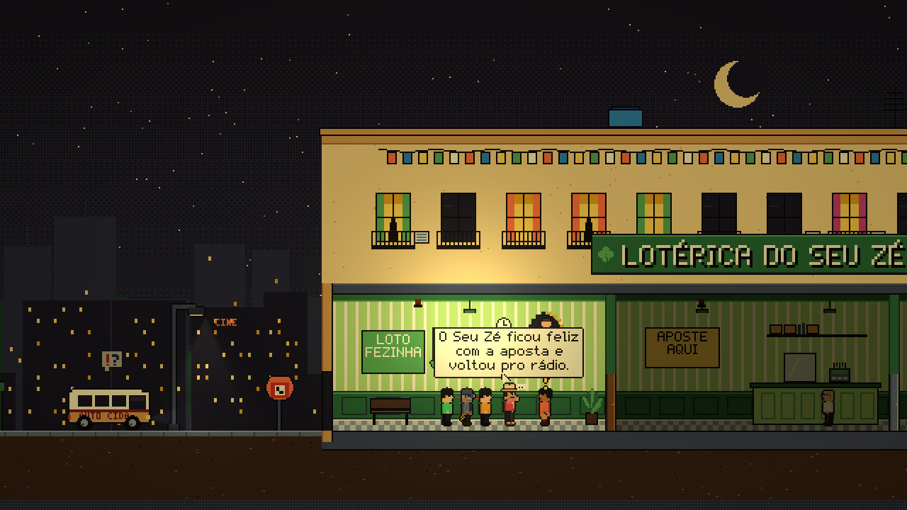
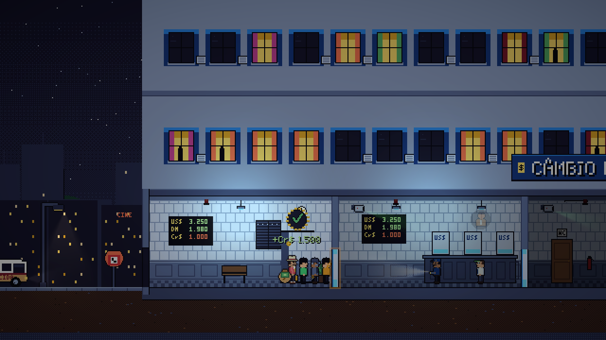
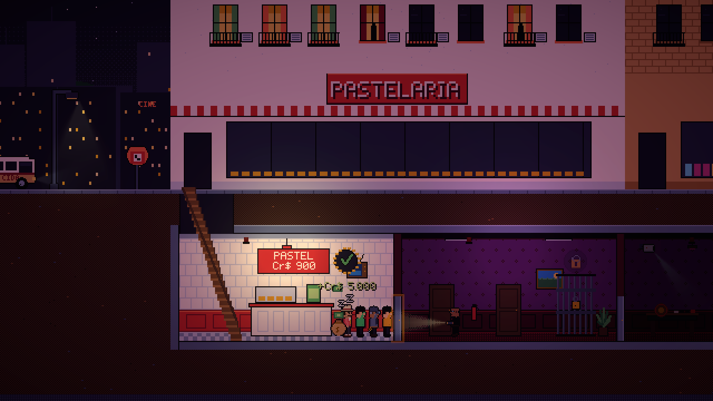
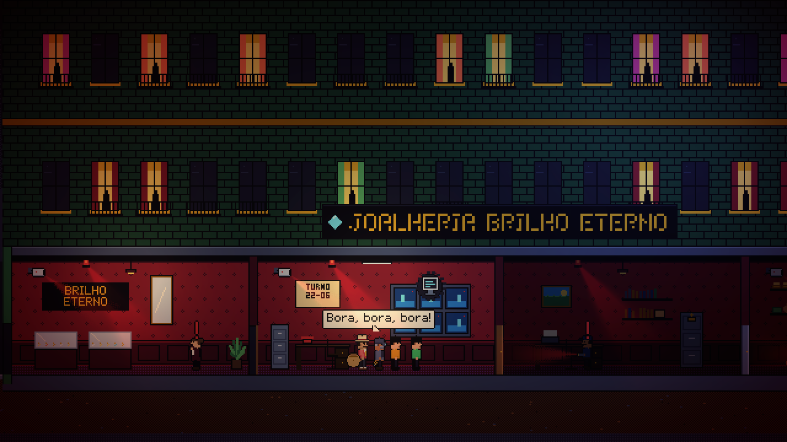
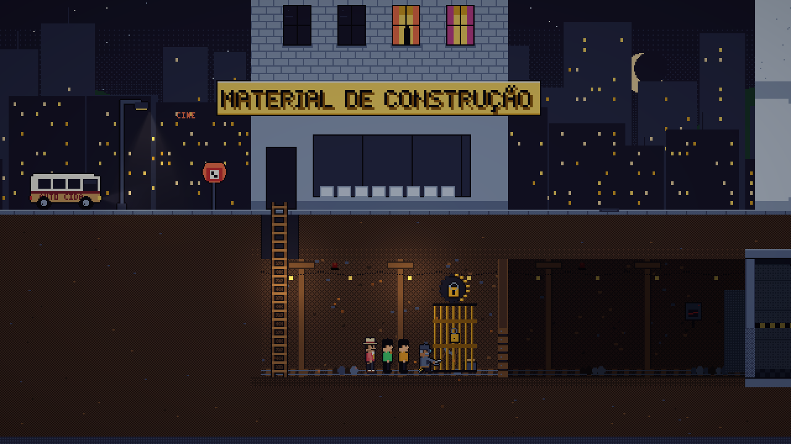
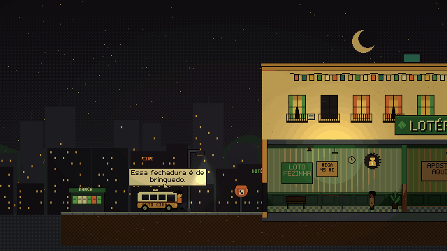

# A Firma — Game Design Document (DDE)

> **Este arquivo é o rascunho do GDD oficial, que vive no Milanote** ([link](https://app.milanote.com/1Xl1js1SfE3bar/a-firma-gdd?p=VXijCZgimVd)).
> Estrutura no framework **DDE: Design → Dynamics → Experience**. As rubricas Blueprint, Mechanics e Interface vêm daí.
> Cada seção tem um dono. Toda quinta o dono atualiza a sua seção aqui e no Milanote, e registra a mudança no fim do documento.

| Seção | Dono |
|---|---|
| 0. Ficha técnica | Nicolas |
| 1.1 Blueprint | Nicolas |
| 1.2 Mechanics | Leonardo (golpe e crew) + Nicolas (economia e progressão) |
| 1.3 Interface | Enzo (UI e áudio) + Miguel (feedback no mundo) |
| 2. Dynamics | Leonardo + Nicolas |
| 3. Experience | Enzo |
| 4. Arte e Som | Miguel + Enzo |
| 5. Produção | Leonardo |

---

## 0. Ficha técnica

| | |
|---|---|
| **Título** | A Firma |
| **Gênero** | Idle / gerenciamento com decisões de risco (push-your-luck) |
| **Plataforma** | Navegador (WebGL, itch.io) |
| **Engine** | Unity 6000.6.4f1, 2D URP |
| **Idioma** | PT-BR |
| **Público** | Quem curte idle, gerenciamento e humor brasileiro; sessões de 10–60 min |
| **Controles** | Só mouse (clique). Esc pausa. |
| **Equipe** | Leonardo, Nicolas, Enzo, Miguel |
| **Referências** | Payday (decisão de assalto), Fallout Shelter (prédio em corte), Taskbar Hero / idles (progressão), Diamant (push-your-luck) |

**Pitch:** Nova Guanabara, anos 90. Você é o cérebro de uma firma de malandros. Monta a crew, escolhe o alvo e assiste ao golpe acontecer sala por sala — mas entre uma porta e outra a decisão é sua: **abrir mais uma ou meter o pé com o que já pegou?**

---

## 1. DESIGN

### 1.1 Blueprint — conceito, mundo e narrativa

**Conceito central.** Um idle em que o "automático" tem tensão: a crew trabalha sozinha, mas cada sala nova é uma aposta. A graça não é clicar rápido, é decidir na hora certa.

**Mundo: Nova Guanabara.** Cidade fictícia que mistura São Paulo e Rio no começo dos anos 90 (por volta de 1992): orelhão, bip, fita K7, lotação, gatonet, jogo do bicho, inflação. Moeda: Cruzeiro (Cr$). Ninguém é vilão de verdade, todo mundo é meio malandro. A firma mora na **Zona Norte** (oficina da Dona Cida, lotérica, cassino debaixo da pastelaria); o **Centro** tem joalheria e câmbio; na **Avenida do Porto** ficam o Banco Central e a polícia.

**Personagens.**
- **O Chefe (jogador):** nunca aparece; é "o cérebro". Todo mundo chama de "chefia", sem gênero definido. Já teve a maior firma de Nova Guanabara e perdeu tudo no Banco Central (a abertura).
- **Dona Cida:** uns 70 anos, lenda aposentada do crime ("nunca deixou pista, só saudade"), dona do esconderijo (a "Auto Elétrica da Cida", oficina de fachada). Dá uma segunda chance pro jogador (a oficina e dois novatos), conduz o tutorial e manda recados por bip. Fala mansa, conselho afiado, deboche com carinho.
- **Delegado Bastos:** antagonista de bigode que adora uma câmera. Promete muito e pega pouco: é piada, não ameaça. Aparece nas manchetes e é promovido a cada prestígio. A abertura é a única vez que ele pega alguém de verdade, e ele nunca mais para de falar disso.
- **A crew:** ladrões gerados com nome + apelido de classe ("Juninho Disquete", "Tião Pé-na-Tábua"), uma manha de personalidade e bordões.

**Os 4 tipos de ladrão.**
| Tipo | Papel | Personalidade |
|---|---|---|
| Pé-na-Tábua | motorista, cuida da fuga | Ex-motorista de lotação pirata, conhece a cidade pelos buracos da rua. Fala como quem tá dirigindo ("segura", "retrovisor limpo"), nunca desliga o motor e ninguém mexe no rádio dele. Medo: lombada eletrônica. |
| Gazua | arrombador, fechaduras e cofres | Ex-chaveiro de plantão da Zona Norte. Fala pouco e fala com as fechaduras como se fossem gente ("calma, minha filha", "essa é das teimosas"). Gorro de lã, lupa de relojoeiro no olho e um molho de duzentas chaves que jura saber de cor. Lubrifica tudo com óleo de máquina de costura. Medo: fechadura eletrônica de teclado ("não tem nem buraco pra conversar"). |
| Disquete | hacker, câmeras e alarmes | _dono escreve_ |
| 171 | vigarista, pessoas e lábia | _dono escreve_ |

**Como a história é contada.** Em pílulas: uma abertura curta, bips da Dona Cida nos marcos, briefing de 2–3 linhas por golpe, capa do jornal *O Guanabarense* no fim de todo golpe, bordões da crew durante o assalto.

**Abertura: o golpe que deu errado** (~40 s, pulável, no Novo jogo). A própria Cena do Golpe toca um golpe roteirizado no Banco Central com a firma antiga do Chefe, um ladrão de cada tipo. As salas caem rápido, a sacola enche, o cofre abre. Toca a sirene, a porta oferece **METER O PÉ** ou **SÓ MAIS UMA**, a crew escolhe "só mais uma" e sai algemada. A cena congela na capa do jornal ("BASTOS PEGA A FIRMA NO BANCO CENTRAL") e o bip da Dona Cida oferece a segunda chance. Em 40 segundos o jogador vê tudo que o jogo tem e aprende a regra principal pelo erro: ganância depois da sirene derruba até a melhor firma. A abertura não mexe no save (não paga, não prende, não gasta bip de marco).

**Objetivo.** Voltar pro Banco Central e fazer direito. O esconderijo mostra o objetivo o tempo todo, com a escada de golpes até lá. Concluir o Banco Central pela primeira vez é a revanche: capa especial do jornal, créditos e o prestígio liberado.

**Arco.** Abertura: a firma cai no Banco Central → Dona Cida dá a segunda chance → golpes crescem (Lotérica → Joalheria → Câmbio → Cassino) → **Banco Central via túnel, a revanche** → **sumir do mapa** (prestígio): a firma desaparece, Bastos jura vingança, a cidade recomeça mais vigiada.

**Tom.** Malandro charmoso: leve, bem-humorado, sem violência explícita. A saída é sempre a lábia ou o improviso, nunca machucar alguém; nada de ofensa, coisa real ou anacronismo. Guia completo, com gírias, tamanhos de texto e exemplos bons e ruins: `Assets/_Project/Narrative/LEIA-ME.md`.

### 1.2 Mechanics — regras e sistemas

**Loop principal**
```
Esconderijo ─▶ Mapa ─▶ Planejamento ─▶ GOLPE ─▶ Jornal ─▶ Esconderijo
   ▲  (upgrades, recrutar, bicos)                              │
   └──────────────────────── Cr$, XP, liberações ◀─────────────┘
```

**Golpe.**
- Sequência de 3 a 7 salas; a última é o cofre. Cada sala tem um obstáculo (Fechadura, Sistema ou Pessoa), uma dificuldade, um loot e uma taxa de alerta.
- **Limpar a sala (automático):** o poder é a Perícia do melhor especialista do obstáculo; sem especialista, 35% da maior Perícia da crew. Tempo = dificuldade × modificador ÷ poder (nunca menos de 0,5 s).
- **Loot:** loot da sala × modificador × manhas (Fominha +20%, Mão-boba +30% em sala de Pessoa) entra na sacola, e todo mundo ganha XP.
- **Alerta por segundo:** taxa da sala × (1 − 0,5 × Discrição média/100) × 2 sem especialista × modificador × manhas (Boca-aberta +20%) × (1 − Fama Sangue-frio%). Não sobe com a crew parada na porta nem durante um evento.
- **Porta:** entre salas o golpe pausa e mostra a próxima (obstáculo, loot estimado, se tem especialista): **próxima sala** ou **meter o pé**.
- **Eventos:** 30% por sala (Pé-frio +50%), filtrados por golpe e tipo de sala e sorteados por peso. Cada um tem 2 ou 3 escolhas: algumas pedem um tipo de ladrão (indisponível mostra o motivo), outras testam um atributo (chance = base + por ponto × melhor atributo da crew). Efeitos: alerta, % da sacola, atraso ou prender alguém (vai em cana no fim do golpe). Todo evento tem pelo menos uma escolha sem requisito; se mesmo assim a crew não tiver nenhuma escolha possível, o evento não abre. O primeiro golpe tem o evento roteirizado do Seu Zé. Hoje são 16 eventos, 3 deles do Pé-na-Tábua e 3 do Gazua (Tranca tetra, Cofrinho atrás do quadro, Porta corta-fogo).
- **Habilidades (uma vez por golpe; o botão diz o motivo quando não dá):**

| Ladrão | Habilidade | Efeito |
|---|---|---|
| Pé-na-Tábua | Cavalo de pau | Fuga perfeita a qualquer hora, até com a polícia chegando: 100% da sacola e ninguém preso (nem quem um evento ia prender) |
| Gazua | Pé-de-cabra | Limpa na hora a sala de Fechadura, com +15 de alerta |
| Disquete | Loop na câmera | Congela o alerta por 15 s |
| 171 | Lábia | −25 de alerta (não dá pra usar com o alerta zerado) |

- **Alerta 100 = sirene:** começa a contagem da polícia: 10 s + Rádio da polícia + Pé-na-Tábua (+4 s) + modificador (Blitz −3 s), nunca menos de 3 s. A contagem corre com a crew trabalhando e parada na porta, e pausa em evento e na pausa do jogo. Saídas possíveis:

| Quando sai | Sacola | Prisão |
|---|---|---|
| Antes da sirene | 100% | ninguém |
| Durante a contagem (inclusive limpando o cofre) | 80% (+10% com Pé-na-Tábua) | ninguém |
| Contagem zerou | 50% (+10% com Pé-na-Tábua) | chance por ladrão: (40% − 15 pontos com Pé-na-Tábua) × (1 − 0,5 × Discrição dele/100) |
| Cavalo de pau (a qualquer hora) | 100% | ninguém |

- **Fim do golpe:** paga sacola × saída × (1 + Lavanderia%) × (1 + Fama Esquema%), uma vez só. Limpar o cofre libera o próximo golpe. Presos vão em cana pelo tempo do golpe e o resto volta disponível. O jornal recebe resultado, XP e nível de cada ladrão e quem subiu de nível.

**Crew.**
- **Ladrão:** tipo, nível 1–10, Perícia, Discrição, Nervos, 1 manha, estado (disponível, no golpe, no bico, preso).
- **Atributos efetivos:** base × manha × (1 + Ferramentas% na Perícia, Tênis de molinha% na Discrição). Nenhum upgrade mexe em Nervos.
- **XP e nível:** 1 XP por sala limpa (Cria da rua +30%, a fração vai somando sala a sala). O próximo nível custa 5 × nível atual e cada nível soma o ganho do tipo de ladrão. No nível 10 para e não guarda XP.
- **Manhas (8):** Fominha (+20% de loot, −15% de Discrição), Pé-frio (+50% de chance de evento), Sangue-frio (+30% de Nervos), Boca-aberta (+20% de alerta), Pão-duro (−40% na fiança), Cria da rua (+30% de XP), Supersticioso (+20% de Nervos, −10% de Perícia), Mão-boba (+30% de loot em sala de Pessoa).
- **Recrutamento:** 3 candidatos que trocam a cada 5 min de tempo real, ou na hora por Cr$ 25 (−10% por nível de Contatos). Nível sorteado de 1 a 1 + Contatos, mais os níveis da Fama Lenda de graça. Custo = Cr$ 50 × 1,8^(nível sorteado − 1) × (1 − Fama Reputação%).
- **Vagas:** a crew começa com 3 (até 8 com Quartos); o golpe começa com 2 (até 4 com Van). Demitir nunca tira o último ladrão nem quem está no golpe.
- **Prisão:** tempo do golpe × (1 − Advogado%), em tempo real (corre com o jogo fechado). Fiança = segundos restantes × Cr$ 2 × manha (Pão-duro) × (1 − Advogado%). Preso não vai pra golpe nem pra bico; preso de novo fica com a pena mais longa.

**Economia.**
- **Cr$** vem dos golpes e dos bicos. O dinheiro nunca fica negativo e toda compra impossível explica o motivo ("Falta Cr$ 70.", "Nível máximo.").
- **Bicos:** ladrões ociosos geram renda passiva, em dobro no bico do próprio tipo. Catar latinha rende sempre, sem ladrão. Cada bico tem a sua cena animada (Lotação pirata, Chaveiro 24h, Gatonet, Bilhete premiado, Catar latinha): vazia fica apagada, com gente mostra o ladrão trabalhando e o "+Cr$" subindo.
- **Ganho offline:** até 4 h, a 50% (bicos e golpes no automático com Repetir).
- **Upgrades:** 9 upgrades do esconderijo com níveis, custo = custo base × crescimento^nível: Van (+1 vaga no golpe), Quartos (+1 vaga na crew), Ferramentas (+5% Perícia), Tênis de molinha (+5% Discrição), Advogado (−10% prisão e fiança), Contatos (recrutas melhores), Lavanderia (+5% loot), Rádio da polícia (+2 s na contagem), Ponto de bico (+10% renda dos bicos), por nível. Novo: Orelhão (+1 golpe no automático ao mesmo tempo, até 3).

**Golpes no automático (segundo plano).**
- Depois de limpar o cofre de um golpe na mão, dá pra mandar uma crew repetir esse golpe sozinha. A ordem define a porta: **Na moita** (sai antes da sirene) ou **Até o cofre** (só sai no cofre ou na sirene). Com **Repetir**, a crew emenda um golpe atrás do outro.
- É o mesmo motor, sem cena: eventos e habilidades são resolvidos por um piloto automático. Rende ~60% do golpe na mão, não libera golpe novo e não gasta bip de marco. 1 golpe no automático no começo, até 3 com o Orelhão. Roda junto com o golpe na mão e com o jogo fechado (offline, sem prisão).
- A faixa **Golpes rolando** no esconderijo mostra cada um: miniatura do prédio, crew, salas, alerta, sacola e giroflex na sirene.

**Progressão.**
- **Golpes:** escada de 5. Concluir o cofre de um libera o próximo; a Lotérica nunca fica bloqueada e todo golpe pode ser repetido. Cada golpe ensina algo: Lotérica (tutorial) → Joalheria (Sistema, pede um Disquete) → Câmbio (mistura e fuga, pede um Pé-na-Tábua) → Cassino (muito alerta, pede as habilidades) → Banco Central (túnel calmo, cofre mais protegido).
- **Golpes extras** (ramo ao lado da escada, fora do caminho pro Banco Central), cada um vitrine de um ladrão: Banca do Bicho do Tonhão (Pessoa, farm barato; libera com a Lotérica), Carro-forte da Avenida do Porto (Fechadura difícil e alerta rápido; libera com o Câmbio), Museu de Nova Guanabara (quase só Sistema; libera com o Cassino).
- **Contexto do golpe:** modificador sorteado × Nível de Procurado (dificuldade ×1,25, loot ×1,5, alerta ×1,1 por nível). A Fama entra direto no motor do golpe.
- **Balanceamento v1:** Banco Central concluído em ~49 min no simulador (meta 40–60). Curva e números em [BALANCEAMENTO.md](BALANCEAMENTO.md).
- **Modificadores:** sorteados a cada visita ao mapa (feriado, dia de pagamento…).
- **Prestígio:** depois do Banco Central, "sumir do mapa" reseta o ciclo, dá Fama e +1 Nível de Procurado (tudo mais difícil e mais rico). A Fama compra 6 bônus permanentes.

**Estados e erros.**
- Save automático com backup.
- Golpe interrompido vira "meteu o pé": paga a sacola salva, a crew volta e ninguém é preso.
- No load: quem cumpriu a pena com o jogo fechado sai; ladrão "no golpe" ou "no bico" sem golpe ou bico de verdade volta pra disponível.
- Anti dead-end: catar latinha; se ninguém está fora da cadeia e não dá pra recrutar (sem Cr$ ou sem vaga), a Dona Cida manda um novato com um bip; a prisão acaba sozinha; a Lotérica nunca fica bloqueada.

_Números atuais: ver [ESCOPO.md](ESCOPO.md) e [BALANCEAMENTO.md](BALANCEAMENTO.md)._

### 1.3 Interface — UI, feedback e controles

**Identidade:** "dossiê da firma": papel kraft, carimbo CONFIDENCIAL, fotos 3x4 dos ladrões, bip pras notificações, jornal no resultado.

**Telas:**
- Menu principal (com "Ver abertura"), Pausa, Opções, Créditos
- Abertura: letreiro, capa do jornal, botão Pular
- Esconderijo (hub) com o objetivo atual, a faixa Golpes rolando, Crew, Contatos, Bicos (cada um com a sua cena), Upgrades e Prestígio
- Mapa da cidade (escada + golpes extras) e Planejamento (golpe na mão ou mandar no automático)
- HUD do golpe, popup de porta, cartão de evento, contagem da polícia
- Jornal, popup offline, bip e tutorial

**Feedback no mundo** (a cena conta o que está acontecendo, sem depender da HUD):
- **Prédio em corte:** cada golpe é um prédio com tema próprio; as salas ainda não visitadas ficam no escuro e a sala atual acende quando a crew entra.
- **Obstáculo e progresso:** o ícone do obstáculo (cadeado, monitor, pessoa) flutua na sala com um anel que enche conforme a crew trabalha. O adereço reage: grade com cadeado, cofre, painel de alarme, CFTV ou a pessoa de posto (Seu Zé, crupiê, bicheiro...).
- **Quem trabalha:** o especialista do obstáculo vai na frente e faz a animação de trabalho (o Gazua ajoelha na fechadura e solta faísca). Sem especialista, o melhor da crew vai com um aviso vermelho na cabeça (mais lento e mais barulho).
- **Sala limpa:** a grade abre, o cofre abre, o painel fica verde, a pessoa fica distraída ("zZ"); notas e moedas voam até a sacola nas costas da crew (que cresce), "+Cr$" sobe da sala, toca o plim e a crew comemora.
- **Decisão de porta:** a crew vai até a porta, a porta pisca e a próxima sala aparece na penumbra com o ícone piscando (e o aviso de "sem especialista").
- **Eventos:** "!?" em cima da crew; depois check ou X e o resultado num balão de fala. Atraso mostra um relógio; perder sacola derruba notas no chão.
- **Vigilância:** guardas com lanterna (luz 2D) patrulhando: calmos, "?" com lanterna amarela a partir de 35 de alerta, "!" com lanterna vermelha a partir de 70, correndo na sirene. Câmeras varrendo a sala com um cone verde → amarelo → vermelho; o Loop na câmera do Disquete apaga as câmeras pelo tempo da habilidade.
- **Alerta:** giroflex vermelho girando no teto a partir de 70%, vinheta que fecha conforme o alerta e luz do prédio que esfria.
- **Sirene:** a viatura chega com o giroflex, luz vermelha/azul entra pela janela, a tela treme e alguém da crew grita.
- **Habilidades:** cada uma tem efeito na sala (o Pé-de-cabra solta faísca, lasca de madeira e um "CREC!" de gibi, e a tela treme).
- **Fuga:** a crew corre de volta pra van e a van arranca (no Cavalo de pau ela rodopia antes); quem foi preso fica algemado pra trás.
- **Balões de bordão** com a fonte pixel do jogo.

**Regras de UX:** botão indisponível sempre explica o motivo; ação irreversível pede confirmação; dinheiro animado.

**Áudio como interface:** a música do golpe ganha camadas com o alerta; cada ação importante tem som.

_Mockups das telas: colar aqui e no Milanote._

Cena do Golpe (prints do jogo):

| | |
|---|---|
|  |  |
|  |  |
|  |  |

---

## 2. DYNAMICS — o que acontece quando os sistemas se encontram

- **Ganância vs. segurança (núcleo).** Cada porta aberta aumenta o loot e o risco. O jogador aprende a ler alerta, obstáculo e crew pra saber a hora de parar. A sirene não é game over, é um segundo nível de aposta (seguir trabalhando com a polícia chegando).
- **Montar a crew é a estratégia.** Golpes misturam obstáculos e as vagas são poucas. Levar o especialista certo, o motorista como seguro ou o 171 pra apagar incêndio são escolhas que mudam o resultado.
- **Recursos que conversam.** Ladrão no bico rende pouco e seguro; no golpe rende muito e arrisca prisão. A fiança tira dinheiro dos upgrades. Upgrades de Perícia e Discrição mudam até onde dá pra ir em cada golpe.
- **Modificadores quebram a rotina.** "Dia de pagamento" convida ao risco; "Blitz" pede cautela. Repetir o mesmo golpe nunca é exatamente igual.
- **Prestígio reescreve a curva.** Com Fama o começo fica rápido e o topo mais difícil (Procurado). Cada ciclo pede uma estratégia um pouco diferente.
- **Mão vs. automático.** Golpe novo e o cofre que libera o próximo são sempre na mão; o automático só farma o que você já domina e rende menos. A crew boa vai pro golpe difícil e a segunda linha fica rodando a Banca do Bicho ou a Joalheria no automático, ou no bico. Cada ladrão tem três lugares pra estar, e escolher é a estratégia do idle.
- **Estratégias emergentes esperadas:** farm seguro de golpe baixo, "uma porta a mais" no limite da sirene, crew especializada vs. generalista, guardar o Cavalo de pau pro cofre, crew "Na moita" farmando enquanto o time principal arrisca na mão.

_Dinâmicas observadas em playtest: registrar aqui (Sprint 2–3)._

---

## 3. EXPERIENCE — o que o jogador deve sentir

| Momento | Sentimento alvo | O que causa |
|---|---|---|
| Primeiros 40 s | Impacto, "eita!", e um objetivo | A abertura: a firma no auge caindo no Banco Central |
| Primeiros 3 min | Curiosidade, "entendi!" | Tutorial curto da Dona Cida, Lotérica fácil |
| Cada porta | Tensão, ganância | Alerta subindo, loot estimado, música crescendo |
| Sirene | Adrenalina | Luzes, viatura, contagem, decisão sob pressão |
| Jornal | Orgulho ou riso | Manchete sobre o que você fez |
| Esconderijo | Planejamento, progresso, "a firma tá rodando" | Upgrades, recrutas, próximo golpe à vista; bicos animados e golpes no automático rolando na tela |
| Banco Central | Clímax e revanche | Golpe longo, túnel, cofre central; o lugar onde tudo deu errado na abertura |
| Prestígio | Recomeço com poder | Fama, cidade nova mais difícil, Bastos promovido |

**Público e sessão:** quem joga no navegador nos intervalos; sessão típica de 10–20 min, primeiro ciclo completo em 40–60 min.

**Anti-experiências (o que evitar):** sentir que o jogo joga sozinho; ficar travado sem dinheiro; tédio de repetir o mesmo golpe sem motivo.

---

## 4. Arte e Som

- **Arte:** pixel art 32×32 (PPU 32), câmera Pixel Perfect em 640×360. **Paleta de 32 cores** (`docs/img/paleta.png`): a noite azulada de Nova Guanabara, a luz quente de interior, o kraft do dossiê, o verde do dinheiro, o vermelho do alarme, o azul da viatura e o neon do cassino. Os 4 ladrões feitos pelo time. Prédios em corte lateral com salas modulares (uma por tipo de sala), desenhados pixel a pixel por script na paleta, cada golpe com tema próprio: Lotérica verde-menta com cartaz de loteria, Joalheria vinho e dourado, Câmbio de vidro azul com a cotação do dólar, Cassino roxo escondido debaixo de uma pastelaria, Banco Central de mármore com o túnel de terra. Fundo da cidade em parallax (morro com luzinhas, prédios com neon) e rua com orelhão, banca de jornal e a Kombi da firma.


- **Idle que se vê:** cena animada de cada bico (96×64, 4–8 quadros), miniatura de cada prédio pra faixa Golpes rolando (com versão de sirene) e, se der tempo, a crew em idle no porão da Cida.
- **VFX:** luzes 2D (lâmpada de cada sala, lanterna dos guardas, cone das câmeras, giroflex, viatura), partículas (faísca e lascas do pé-de-cabra, poeira do túnel, fumaça do escapamento), notas voando, vinheta e bloom leve por pós-processamento, screen shake na sirene.
- **Música:** esconderijo (samba-jazz/bossa lo-fi), golpe com camadas de tensão, sirene, menu.
- **SFX:** UI, ações dos ladrões, loot, alarme, sirene, bip, máquina de escrever do jornal. A cena toca o som de ação do ladrão quando ele começa a trabalhar, o plim da grana na sacola e a porta abrindo (sons da cena e do Gazua sintetizados por script).

Detalhes e lista de packs: [ASSETS.md](ASSETS.md).

---

## 5. Produção

- **Equipe e frentes:** ver [ESCOPO.md §13](ESCOPO.md#13-divisão-do-time).
- **Cronograma:**
  - S0 Fundação (20–22/10)
  - S1 Primeiro golpe (23–29/10)
  - S2 Jogo completo (30/10–05/11, feature freeze)
  - S3 Polimento e entrega (06–11/11)
- **Ferramentas:**
  - Unity 6
  - GitHub (código, board, issues)
  - Milanote (GDD)
  - Google Sheets (balanceamento)
  - craftpix.net
  - Aseprite/Blender (arte, IA permitida)
- **Board:** <https://github.com/users/souzxxx/projects/2>

---

## Registro de mudanças (documento vivo)

| Data | Seção | Mudança | Por quê |
|---|---|---|---|
| 20/10/2026 | Todas | Primeira versão do GDD a partir do escopo | Início do projeto |
| 20/10/2026 | Mechanics | Fuga durante a sirene passa a custar 20% da sacola | Dar função ao Cavalo de pau e manter a sirene como aposta |
| 20/10/2026 | Blueprint | Tipos renomeados pra Pé-na-Tábua, Gazua, Disquete e 171; Atirador vira 171 (vigarista) | Tom malandro charmoso, sem violência |
| 21/10/2026 | Mechanics | Golpe e crew descritos com as regras implementadas: alerta, sirene, saídas, prisão, eventos, habilidades, XP, manhas, recrutamento e fiança | Fim da Sprint 1: motor e crew reais no jogo |
| 21/10/2026 | Mechanics | A Discrição de cada ladrão reduz a chance dele ser preso na fuga forçada | O ESCOPO já pedia; dá peso à Discrição fora do alerta |
| 21/10/2026 | Mechanics | Fama Lenda dá níveis de graça no recruta (o preço é o do nível sorteado); trocar candidatos fica mais barato com Contatos | Bônus de Fama que não se anula; Contatos com o efeito "troca mais barata" do ESCOPO |
| 21/10/2026 | Mechanics | Lábia não pode ser usada com o alerta zerado; evento sem nenhuma escolha possível não abre | Habilidade não é gasta à toa; golpe nunca trava |
| 21/10/2026 | Blueprint | Personalidade do Pé-na-Tábua | Dono do ladrão escreveu |
| 25/10/2026 | Blueprint | Bíblia do mundo (época, lugares, Dona Cida, Bastos, jeito de falar de cada tipo) e guia de tom | Todo mundo escreve texto: o guia deixa tudo coeso |
| 25/10/2026 | Mechanics | Economia e progressão reais no jogo; balanceamento v1 (Joalheria e Câmbio mais difíceis, Cassino e Banco Central mais fáceis) | Simulador: o Cassino era parede e o Banco Central nunca era concluído |
| 25/10/2026 | Blueprint | Bips da Dona Cida nos marcos e briefings revisados com a dica de cada golpe | História em pílulas (ESCOPO §5) |
| 25/10/2026 | Todas | GDD montado no Milanote em colunas DDE, com o mesmo conteúdo deste arquivo | O GDD oficial é o do Milanote (rubrica obrigatória) |
| 26/10/2026 | Blueprint | Personalidade do Gazua e 3 eventos dele (Tranca tetra, Cofrinho atrás do quadro, Porta corta-fogo) | Dono do ladrão escreveu; cada ladrão tem momentos em que só ele resolve |
| 26/10/2026 | Interface | Feedback no mundo implementado: prédio em corte, ícone e anel de progresso, adereço que abre, notas voando pra sacola, guardas e câmeras por faixa de alerta, giroflex, vinheta, viatura, balões e fuga na van | Rubrica Feedback: dá pra entender o golpe olhando a cena, sem a HUD |
| 26/10/2026 | Arte e Som | Paleta de 32 cores e direção de arte da cena; os packs de cenário do craftpix ficaram só como referência (escala 3× a do jogo) | Arte coesa numa paleta única, sem colagem de packs |
| 26/10/2026 | Mechanics | Pé-de-cabra explica o motivo quando não dá ("Só serve em sala de Fechadura.", "Espera a crew entrar na sala.") | Botão indisponível sempre diz o motivo |
| 27/10/2026 | Blueprint, Interface, Experience | Abertura: a firma do Chefe cai no Banco Central e a Dona Cida dá a segunda chance. Objetivo do jogo: voltar pro Banco Central e fazer direito (a revanche) | Objetivo claro desde o primeiro minuto (anti-objetivo: idle sem objetivo); a abertura mostra o jogo todo e ensina a regra da sirene pelo erro |
| 28/10/2026 | Mechanics, Interface, Dynamics, Experience, Arte | Golpes no automático em segundo plano (faixa Golpes rolando, upgrade Orelhão), cena animada em cada bico, 3 golpes extras (Banca do Bicho, Carro-forte, Museu) | Pedido do professor na avaliação: mais visual na parte idle, golpes rodando em segundo plano pra passar a sensação de idle, e mais golpes |
